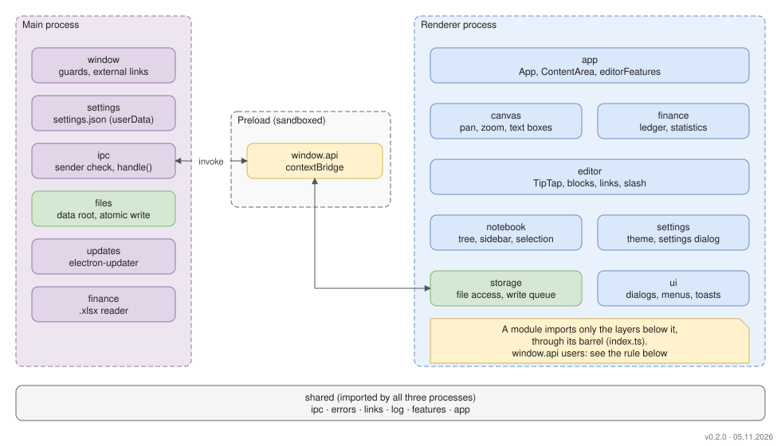

# Architecture

This page shows how MyNote is split into processes and renderer modules, which imports are allowed, and where the feature flag, the logging levels and the comment rules are defined.

Three processes and one shared folder. The only way from the renderer to the main process is the arrow through `window.api`. Inside the renderer the modules are drawn as layers; the table below lists the exact imports.

## Processes

| Process | Folder | Owns |
|---|---|---|
| Main | [`application/src/main`](../../application/src/main) | the data root and all file access, atomic write, settings, update check, window and its guards, the `.xlsx` reader, the IPC handlers |
| Preload | [`application/src/preload`](../../application/src/preload) | `window.api: MyNoteApi` through `contextBridge`, one `ipcRenderer.invoke` per request channel and `ipcRenderer.on` / `removeListener` for the one event (`links.onOpenFailed`), nothing else |
| Renderer | [`application/src/renderer/src`](../../application/src/renderer/src) | the whole UI, split into the modules below |
| Shared | [`application/src/shared`](../../application/src/shared) | code both sides import, without Electron: `ipc.ts` (channels, `MyNoteApi`), `errors.ts`, `links.ts`, `log.ts`, `features.ts`, `app.ts` |

- `main` and `preload` never import renderer code (lint rule).
- The window runs with `sandbox` and `contextIsolation`, without `nodeIntegration`. It refuses navigation to anything but the app page and answers every permission request with "no" (`main/window/mainWindow.ts`).
- Details: [IPC](main/ipc.md), [files](main/files.md), [updates](main/updates.md), [.xlsx reader](main/finance-xlsx.md).

## Renderer modules and import direction

| Module | May import | Holds |
|---|---|---|
| `ui` | nothing | dialogs, context menu, toasts, button styles, `usePointerDrag` |
| `storage` | nothing | folder-relative file access, write queue, ids, value checks |
| `settings` | `storage`, `ui` | theme, settings dialog |
| `notebook` | `storage`, `ui` | notebook tree, store, manifest persistence, sidebar, welcome screen |
| `editor` | `notebook`, `storage`, `ui` | TipTap setup, `EditorFeature`, blocks, slash command, links, toolbar |
| `canvas` | `editor`, `notebook`, `storage`, `ui` | canvas view, text boxes, viewport, minimap, content store |
| `finance` | `editor`, `notebook`, `storage`, `ui` | ledger and statistics blocks, finance store, import and export |
| `app` | all of the above | `App`, `ContentArea`, `ErrorBoundary`, `editorFeatures.ts` |

- A module is used only through its barrel `@renderer/<module>` (`index.ts`). A deep import (`@renderer/ui/Modal`) or a relative path into another module is an error.
- `app/` is the one folder without a barrel. `main.tsx` imports `./app/App` and `./app/ErrorBoundary` directly, and calls `startContentSync` (`canvas`) and `applyThemeBeforeFirstPaint` (`settings`).
- The editor never imports `finance`. `finance` builds an `EditorFeature` (`finance/feature.ts`), and `app/editorFeatures.ts` hands the list of features down through `ContentArea` and `CanvasView` to each `TextBox` ([feature registry](renderer/editor/feature-registry.md)).
- The table is the `MODULES` list in [`application/eslint.config.js`](../../application/eslint.config.js); `npm run lint` fails on a violation.

## The `window.api` rule

- Only `storage`, `settings`, `editor/links/openFailed.ts` and `finance/transfer/` may touch `window.api` (tests and `*.testing.ts` may fake it). Everything else reaches files and dialogs through `@renderer/storage`.
- `confirm`, `alert` and `prompt` (also as `window.confirm`) are banned in the renderer. Use `ConfirmDialog`, `Modal` or `notify` from `@renderer/ui` ([ui](renderer/ui.md)).

## Feature flag `MYNOTE_FINANCE`

`electron.vite.config.ts` defines `__FEATURE_FINANCE__` for main, preload and renderer: true unless the environment variable `MYNOTE_FINANCE` is `off`. `shared/features.ts` exposes it as `FEATURE_FINANCE`; the unit tests define it as true.

| Place | Flag on | Flag off |
|---|---|---|
| `main/index.ts` | `registerXlsxIpc()` registers `xlsx:importSheet` | no handler for that channel; the preload still exposes the bridge |
| `app/editorFeatures.ts` | `[coreBlocks, financeFeature]` | `[coreBlocks, financePlaceholderFeature]` |

With the flag off, stored ledger and statistics blocks still load and keep their attributes; they show "Finance module not included in this build" and no slash item inserts one ([persistence](renderer/finance/persistence.md)). How the build sets the flag: [build and release](build/build-and-release.md).

## Maturity and logging

| Level | Started by | Vite mode | Debug logs |
|---|---|---|---|
| dev | `electron-vite dev` | `development` | on |
| experimental | `npm run build:experimental` | `experimental` | on |
| release | `npm run build` | `production` | off |

`createLogger(module)` in `shared/log.ts` gives `debug`, `info`, `warn` and `error` with the prefix `[module]`. `debug` prints unless the mode is `production`; the other three always print. `console` is used nowhere else (lint rule `no-console`).

## Comment convention

- A comment is one line at most. Longer knowledge goes into a page here and the comment links to it: `// See documentation/software/main/files.md`.
- Markers: `NAMING-CHECK` (a name that is unclear or conflicts with the [glossary](../glossar.md)), `DEADCODE-CHECK` (probably unused, not yet removable), `CHECK:` (an obvious bug that was left in place) and `DEAD CODE` (unused code that was left in place).

## All software pages

- Build: [build and release](build/build-and-release.md) · [release flow](build/release-flow.drawio.svg) · [SBOM](build/sbom.md)
- File format: [file format](file-format/file-format.md) · [notebook folder](file-format/notebook-folder.drawio.svg) · schemas [notebooks](file-format/notebooks.schema.json), [page content](file-format/page-content.schema.json), [TipTap document](file-format/tiptap-document.schema.json)
- Main process: [IPC](main/ipc.md) · [files](main/files.md) · [data root](main/data-root.drawio.svg) · [updates](main/updates.md) · [.xlsx reader](main/finance-xlsx.md)
- Renderer `ui`: [ui](renderer/ui.md)
- Renderer `notebook`: [notebook](renderer/notebook/notebook.md) · [data model](renderer/notebook/data-model.drawio.svg) · [content lifecycle](renderer/notebook/content-lifecycle.drawio.svg)
- Renderer `canvas`: [canvas](renderer/canvas/canvas.md) · [coordinate model](renderer/canvas/coordinate-model.drawio.svg)
- Renderer `editor`: [feature registry](renderer/editor/feature-registry.md) · [live blocks](renderer/editor/live-blocks.md) · [table](renderer/editor/table.md) · [slash command](renderer/editor/slash-command.drawio.svg) · [links](renderer/editor/links.drawio.svg)
- Renderer `finance`: [data files](renderer/finance/data-files.md) · [persistence](renderer/finance/persistence.md) · [import and export](renderer/finance/import-export.drawio.svg) · [statistics](renderer/finance/statistics.drawio.svg)
- Names: [glossary](../glossar.md)
