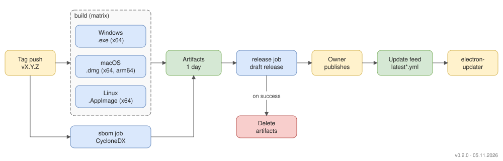

# Build and release

How MyNote is built, checked and shipped: one toolchain pinned by `.nvmrc`, a CI gate on every change and a tag-driven release that ends in a draft GitHub Release.

## Environment and Node pin

| What | Where | Rule |
|---|---|---|
| Node (exact version) | `.nvmrc` (`26.13.0`) | Read by `actions/setup-node` (`node-version-file`) and by nvm. `check-latest: true` stays set; with an exact version it does not change which release is installed. The devcontainer does not read the file |
| Devcontainer | `ARG NODE_VERSION` in `.devcontainer/Dockerfile` | Hard-coded copy of the exact version, kept equal to `.nvmrc` by hand (neither the Dockerfile nor `devcontainer.json` reads the file); the official `node` image of that version (Debian bookworm), user `node`, Electron's native libraries, `npm ci` after creation |
| Node floor | `engines.node` in `application/package.json` (`>=26.12.1`), repeated in the root entry of `package-lock.json` | npm warns with `EBADENGINE` when the local Node is older; raised when a security fix sets a new floor, see [Why the pin is exact](#why-the-pin-is-exact) |
| npm | bundled with that Node | No separate pin; `engines.npm` requires npm 11 or newer |
| Electron | `devDependencies.electron` | Brings its own Chromium and Node; `process.versions` shows them at run time, see [Electron's embedded Node](#electrons-embedded-node) |

- There is no Node on the host: run every npm command in the devcontainer (the tasks in `.vscode/tasks.json` run `npm` commands in `application/`).
- To change the Node version, set `.nvmrc` and `ARG NODE_VERSION` to the same exact version, raise `engines.node` if a security fix sets a new floor, rebuild the devcontainer, run `npm ci` in it and commit `application/package-lock.json` if it changed.
- Both workflows log the exact `node`, `npm` and V8 versions. CI only prints them; the release writes one `runtime-versions-*.txt` per runner and attaches them to the draft release.

### Why the pin is exact

A pin to the major (`26`) lets stale Docker layers and runner caches keep an old, vulnerable patch release; the exact version removes that. The floor `>=26.12.1` comes from CVE-2026-111497:

- Node releases before 26.12.1 (21.10.2026) bundle a Brotli decoder with an out-of-bounds write that can lead to remote code execution. The same release fixes several TLS and DNS CVEs; 26.13.0 (28.10.2026) contains everything from 26.12.1. Source: <https://nodejs.org/en/blog/vulnerability/october-2026-security-releases>.
- Node carries the fix as a cherry-pick, so `process.versions.brotli` says nothing. `node -p "require('zlib').constants.BROTLI_DECODER_ERROR_FORMAT_BLOCK_SWITCH"` prints `-17` in a fixed Node and `undefined` in a vulnerable one.

### Electron's embedded Node

The Node pin covers the toolchain, not the packaged app: the app runs on the Node inside Electron. `electron@42.11.18` (the version in the lockfile) embeds Node 24.19.0, which predates the fix (24.22.1); Electron 43.8.6, 44.10.1 and 45.2.1 embed Node 24.22.1. Source: <https://artifacts.electronjs.org/headers/dist/index.json>.

Nothing in `application/src`, `electron-updater` or `builder-util-runtime` calls the Brotli decoder; the xlsx reader uses only `inflateRawSync`.

## CI gates

`ci.yml` runs on pushes and pull requests to `main` that touch `application/**`, `.nvmrc` or the workflow, with read-only permissions. In `application/` it runs `npm ci`, the SBOM check (see [SBOM](sbom.md)), `npm run lint` (fails on warnings), `npm run typecheck`, `npm test` and `npm run build`, then prints the runtime versions.

CI is a pure quality gate: it proves that the code lints, type-checks, passes its tests and builds. It deliberately uploads no artifact; installable binaries come only from the release workflow on a version tag.

## Release flow

A version tag builds the installers on three runners and the SBOM beside them; the release job collects both into a draft release that the owner publishes.

| Job | Runs on | Does | Hands over |
|---|---|---|---|
| `build` (matrix, `fail-fast: false`) | Windows, macOS, Linux runners | `npm ci`, record runtime versions, stamp the version, `npm run dist` | artifacts `installer-*` and `runtime-versions-*`, one per runner |
| `sbom` | Linux runner | stamp the version, generate and check the CycloneDX SBOM | artifact `sbom` |
| `release` (`needs: build, sbom`) | Linux runner | download all artifacts, create the draft release named after the tag, with generated notes, delete the artifacts | the draft GitHub Release |

- The trigger is a tag `vMajor.Minor.Patch`. `npm version "${GITHUB_REF_NAME#v}" --no-git-tag-version --allow-same-version` stamps the tag's number into `package.json` before the build, so every binary and the SBOM carry it.
- `npm run dist` is `npm run build` plus `electron-builder --publish never`. The installers land in `application/dist/`.
- The owner publishes the draft by hand. Before that nothing is public and no update is offered.

### Updater metadata

The `publish` block in [`electron-builder.ts`](../../../application/electron-builder.ts) names GitHub Releases as the update feed. electron-builder then writes the update metadata next to the installers: `latest.yml` (Windows) and `latest-linux.yml` (Linux), plus `*.blockmap` files for differential downloads. `electron-updater` in the app reads `latest*.yml` from the newest published release; drafts and pre-releases are invisible to it.

The build runs with `--publish never`, so electron-builder only creates the files. Uploading is the job of the release workflow, which attaches them to the draft. The upload step of a runner takes the installer, `application/dist/*.blockmap` and `application/dist/latest*.yml` for that OS. `if-no-files-found: error` trips only when the whole set is empty, so a runner passes as long as at least one of these files exists.

### Artifact hand-off

The artifacts only carry the files from the runners to the release job (`retention-days: 1`). They are no archive: the installers live on the GitHub Release afterwards. The release job deletes the artifacts; the one-day retention is the backstop if that step ever fails.

### Artifact cleanup

Once the release exists, the artifacts are a second copy of three installers; the installers themselves stay on the release. The step `Delete hand-off artifacts` removes the artifacts through the API (permission `actions: write`) at once and frees the Actions storage, instead of waiting out the retention.

- It is `continue-on-error`: a failed cleanup never fails a release that was created.
- It is deliberately not `if: always()`. It runs only after the release step succeeded. If that step failed, the artifacts are the only copy of the installers and must survive.

## SBOM job

Every release carries one mandatory CycloneDX SBOM, built from the lockfile: `release` needs the `sbom` job, so a release without an SBOM cannot be created. Details, local generation and the nightly vulnerability scan are in [SBOM](sbom.md).

## Maturity modes and log level

| Level | Command | Vite mode | `debug` logs |
|---|---|---|---|
| dev | `npm run dev` (`electron-vite dev`) | `development` | on |
| experimental | `npm run build:experimental` (`--mode experimental`) | `experimental` | on |
| release | `npm run build`, `npm run dist` | `production` | off |

`createLogger(module)` in [`application/src/shared/log.ts`](../../../application/src/shared/log.ts) takes the mode from `import.meta.env.MODE`, which Vite replaces with the mode of the build command (the main process is its only user). `debug` is skipped when the mode is `production`; `info`, `warn` and `error` always log. [`electron.vite.config.ts`](../../../application/electron.vite.config.ts) sets no mode, so the level comes from the command alone. The debug calls stay in the bundle; the check runs at run time.

## Feature flag `MYNOTE_FINANCE=off`

`electron.vite.config.ts` reads `MYNOTE_FINANCE` (on unless it is `off`) and defines `__FEATURE_FINANCE__` for main, preload and renderer; `FEATURE_FINANCE` in `@shared/features` exposes it. The test config defines it as `true`.

| With `off` | Result |
|---|---|
| Left out | the finance feature of the editor (slash items, ledger and statistics views, store, import and export, charts) and the xlsx IPC in main |
| Kept | the schema-only nodes `financeLedger` and `financeStats` (`finance/nodes.ts`): a page that holds them still opens and is saved unchanged; the block shows "Finance module not included in this build" |

The finance UI disappears from the bundle because of `"sideEffects": ["*.css"]` in `application/package.json`. It tells the bundler that every module except CSS files is free of import side effects, so a module whose exports nothing uses is dropped as a whole. Without the field, top-level calls such as `memo(...)`, `create(...)`, `joinPath(...)` or `Node.extend(...)` count as side effects and keep the UI and the store in the bundle.

Rule: a module that is imported only for its side effects must be a CSS file, or the build drops it.

## Packaging targets

[`electron-builder.ts`](../../../application/electron-builder.ts) packages `out/**` into `application/dist/` with the app id `APP_ID` (`io.github.tiro1999.mynote`).

| OS | Target | Architecture | Note |
|---|---|---|---|
| Windows | NSIS installer `.exe` | x64 | assisted wizard: install folder and per-user (default) or per-machine |
| macOS | `.dmg` | x64, arm64 | no zip target |
| Linux | `.AppImage` | x64 | |

`npm run dist:win`, `dist:mac` and `dist:linux` build one platform; all run `npm run build` first and `--publish never`.

## macOS update gap

Windows and Linux builds update from the published release. macOS does not: the mac target in `electron-builder.ts` is a `.dmg` only, and electron-updater's macOS updater needs a `.zip` in the update information (it fails with "ZIP file not provided" otherwise), which the build does not produce. `main/updates/updates.ts` skips the startup check on macOS and answers a manual check with `unsupported`; the Settings dialog then says "Updates are not available on macOS yet. Download new versions from GitHub Releases."

See also [SBOM](sbom.md), the [file format](../file-format/file-format.md) and the [glossary](../../glossar.md).
