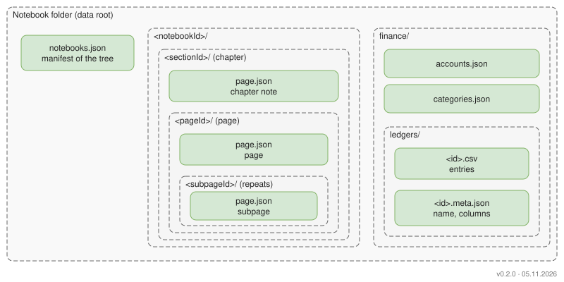

# MyNote file format

How MyNote stores notebooks on disk: plain folders, JSON files and one CSV per ledger. There is no database and no server, so a notebook folder can be backed up, inspected and repaired by hand.

The folder the user opens (code: `dataRoot`) holds everything. A folder is created by the first file written into it.

| File | Holds | Schema |
|---|---|---|
| `notebooks.json` | the whole tree: notebooks, chapters, pages, subpages (the manifest) | [`notebooks.schema.json`](notebooks.schema.json) |
| `<notebookId>/<sectionId>/page.json` | the canvas of a chapter (its chapter note) | [`page-content.schema.json`](page-content.schema.json) |
| `<notebookId>/<sectionId>/<pageId>/page.json` | the canvas of a page; a subpage folder sits inside its parent page folder | same |
| `content` of a text box | rich text as TipTap/ProseMirror JSON | [`tiptap-document.schema.json`](tiptap-document.schema.json) |
| `finance/…` | accounts, categories and the ledgers, see [Finance files](#finance-files) | – |

The schemas use JSON Schema draft 2020-12 and describe what MyNote writes. Register all three with a validator, because `page-content` refers to `tiptap-document` by a relative `$ref` (ajv 8 with `ajv-formats` checks the `date-time` fields). The loader is more lenient than the schemas in the places named under [Validation rules](#validation-rules). Update the schemas whenever `notebook/model.ts`, `canvas/model.ts`, the editor extensions or `finance/nodes.ts` change; `notebook/persistence.test.ts` reads `notebooks.schema.json`.

## A new page

A new chapter or page is only an entry in `notebooks.json`. Its folder and `page.json` appear with the first content save, for example when the first text box is added. No `assets/` folder is created. A missing `page.json` opens an empty canvas. Deleting a chapter or page saves the manifest first and then removes the folder with everything below it; the `finance/` data is not part of any page folder.

## Persisted names

The files keep the spelling of v0.1.x. The [glossary](../../glossar.md) maps each name to the UI.

| Persisted key | UI term |
|---|---|
| `sections`, `sectionId` | Chapters of a notebook, the chapter a page belongs to |
| `notebookId` | the notebook a chapter belongs to |
| `pages`, `children` | Pages of a chapter, subpages of a page |
| `collapsed` | fold state of a chapter or page in the sidebar |
| `pageId`, `elements` | id of the chapter or page that owns the canvas, its canvas elements |
| `textbox` (element `type`), `zIndex` | Text box, its stacking order |
| `callout`, `tocBlock`, `pageHierarchyBlock` | Callout, Table of contents, Page hierarchy |
| `financeLedger`, `financeStats`, `ledgerId` | Ledger block, Statistics block, the ledger a block is bound to |
| `accountId`, `categoryPath`, `referenceLink` | Account, Category, Receipt link (ledger CSV columns) |

For a chapter note the `pageId` of its `page.json` is the chapter's `id`.

## Legacy nodes

Pages written by v0.1.x load as they are. These parts are loaded and kept; MyNote does not create them:

- `templateLink`, an inline node with `kind`, `targetId` and `label`. It stays registered so the page does not load empty. A link of kind `page` opens the page; one of kind `heading` does nothing.
- The `id` attribute of a heading. The heading has no such attribute, so it is dropped on load.
- Canvas elements of type `image` and `file` (with an `assetPath` below an `assets/` folder). They are never drawn and the folder is never read, but the element stays in `page.json` and is saved with it.
- Unknown fields on notebooks, chapters, pages, the page content and its elements.

A node type that no extension registers does not load empty: the text box opens read-only, shows a notice and keeps its stored content.

## Finance files

Accounts and categories are shared by all ledgers of a notebook folder.

| File | Content |
|---|---|
| `finance/accounts.json` | list of `{ id, name, openingBalance }`; `openingBalance` is text such as `-120.50` |
| `finance/categories.json` | tree of `{ name, children }`; a category path joins the names with `/`, for example `Food/Groceries` |
| `finance/ledgers/<id>.meta.json` | `{ name, currencySymbol, columns? }`; `columns` is keyed `date`, `type`, `amount`, `account`, `category`, `topic`, `tags` with `align`, `width` and, for `amount`, a `number` format |
| `finance/ledgers/<id>.csv` | the entries of one ledger |

The ledger CSV has this header and ten cells per row: `id,pos,date,type,amount,accountId,categoryPath,topic,tags,referenceLink`.

- The separator is a comma, text with `"`, `,` or a line break is quoted, and rows are separated by CRLF. A leading byte-order mark is ignored on reading. A file with another header, for example one that a German Excel re-saved with `;`, is refused, not repaired.
- `date` is `YYYY-MM-DD`, `type` is `income` or `expense`, `tags` are joined with `;`, `referenceLink` is the path of a receipt file.
- `amount` is canonical dot-decimal text with two decimals, such as `12.50`, for every entry written by v0.2.0 or later. A stored ledger loads leniently: amounts written by v0.1.x (such as `12,5`) stay as they are, and no row is dropped.

## Validation rules

Every id that becomes a path segment must match `/^[A-Za-z0-9_-]{1,64}$/`: notebook, chapter and page ids and the ledger id. Ids of the same kind are compared without case, because folder names ignore case on Windows and macOS; a chapter and a page may share an id. The notebook id `finance` is reserved in any case, because the folder `finance/` holds the finance data.

| File | Rejected as corrupt | Backfilled or kept |
|---|---|---|
| `notebooks.json` | not a list; an invalid or repeated id; the reserved notebook id; `name`, `color`, `title`, `createdAt`, `updatedAt`, `notebookId` or `sectionId` that is no text; `collapsed` that is no boolean; `sections`, `pages` or `children` that is no list | a missing `sections`, `pages` or `children` becomes `[]`; `collapsed` stays optional; unknown fields are kept |
| `page.json` | not an object; `pageId` that is no text; `elements` that is no list; an element without a text `id` and `type`; a text box without finite `x`, `y`, `width`, `height`, `zIndex` or without an object `content` | a missing `pageId` takes the id of the opened chapter or page, a missing `elements` becomes `[]`; unknown fields and other element types are kept |
| `accounts.json`, `categories.json` | a wrong type anywhere; an empty or repeated account `id`; categories nested deeper than 32 levels | fields the type does not have are dropped |
| `<id>.meta.json` | a wrong type anywhere, `align` or `symbolPosition` outside their choices, `width` that is not above 0 | `decimals` is cut to a whole number from 0 to 20; fields the type does not have are dropped, also `type` and `date` of a column |
| `<id>.csv` | another header; a row without ten cells | values stay as stored |

A JSON file that is no valid JSON, or that fails these checks, is rejected as corrupt. It is shown as an error and never written back, so nothing is overwritten:

- `notebooks.json`: the folder does not open and the welcome screen shows "Couldn't open the notebook folder: …".
- `page.json`: the canvas shows "Couldn't open this page: …" and the page is not saved.
- finance files: the ledger shows a red box with "This ledger was not changed." or "They are not changed.", and every write to those files is refused.

The content of a text box is not checked by the loader beyond being an object. The editor checks it when the box opens (see above).

## Writing

- Every write is atomic. Main writes a temporary file `<name>.<12 hex>.tmp` next to the target, flushes it to disk and renames it over the target. A brief lock (`EPERM`, `EACCES` or `EBUSY`, for example from a sync client, a virus scanner or Excel) is retried: five rename attempts in all, 100 ms apart. If the write still fails, the temporary file is removed and the old file stays as it was. The error is shown: a toast for `notebooks.json` and `page.json`, "Not saved: …" in a ledger.
- The renderer queues the writes of one path: one write is in flight and the newest text waits behind it. A read of the same path waits for the queued writes first.
- JSON files are written with two-space indentation. `notebooks.json` is rewritten completely on every tree change; page content is saved 400 ms after the last edit, and at once when a text box is added or deleted.
- On quit, main waits up to ten seconds for writes that are still running.

Main-side details are in [Files in main](../main/files.md); the finance side is in [Finance data files](../renderer/finance/data-files.md).

## Versioning

The files carry no `formatVersion`. The format is the implicit first version: v0.1.x folders open as before, lists added later are backfilled and unknown fields are kept. A change that older versions could not read needs an explicit `formatVersion` first.
