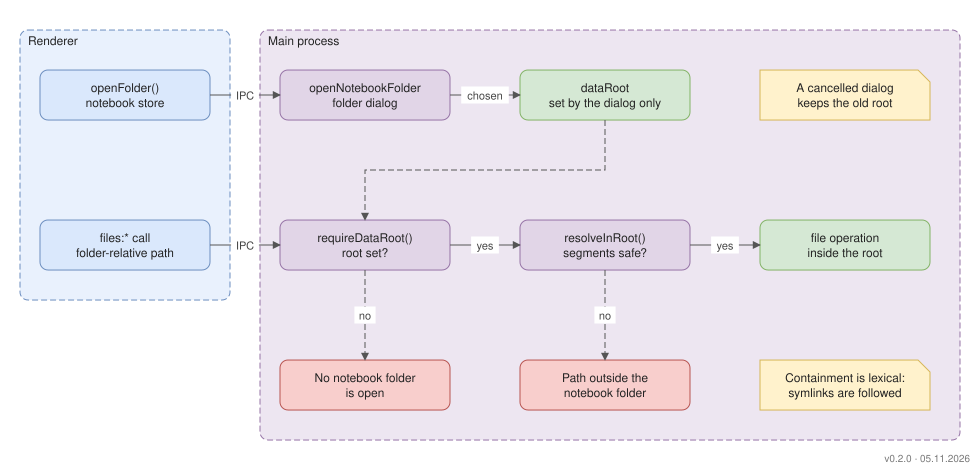

# Files in the main process

This page explains how main owns the data root, how a relative path is contained in it, how a file is written atomically, and how pending writes are handled when the app quits.

The folder dialog is the only way to set the data root. Every `files:*` call is checked against it before a file is touched.

## Data root

- The root is the module variable `dataRoot` in [`application/src/main/files/files.ts`](../../../application/src/main/files/files.ts). Only `dialogs:openNotebookFolder` sets it, and only when the user picks a folder; a cancelled dialog keeps the previous one.
- Before a folder is open, every `files:*` call throws `No notebook folder is open`. `files.importText` and `files.exportText` check this before they open a dialog. `dialogs.pickFile` and `xlsx.importSheet` need no root, because they only read.
- The renderer keeps its own `dataRoot` (the path the dialog returned) for display and as the "folder is open" gate; it is set only after the manifest was read. Main's root changes earlier: when the manifest turns out corrupt, the renderer shows the error and stays on the welcome screen, while main already uses the new folder. Nothing is written in that state.
- The dialog opens only while no folder is open (the welcome screen), so there is no folder switch today. Any code that lets the user switch the folder must `flushWrites()` from `@renderer/storage` first: text still queued for the old folder would otherwise be sent after the switch and main would resolve it against the new root.

## Path containment

[`application/src/main/files/scope.ts`](../../../application/src/main/files/scope.ts) (`resolveInRoot`) turns the relative path into an absolute one:

- The path is split on `/`. Every segment must be non-empty, not `.` or `..`, and free of `\`, `:` and NUL, and does not end with a space or a dot (Windows drops them, so `.. ` would name the parent); otherwise `Path outside the notebook folder: <path>`.
- So the folder itself (`''`) cannot be read, listed or removed. The segments are joined with the platform `path.join`, so Windows folders such as `D:\Sync\OneDrive\Notes` work.
- The check is lexical. A symlink inside the notebook folder is followed, and Windows reserved names (`CON`, `NUL`, …) are not rejected.

## Operations

| Channel | Result |
|---|---|
| `readText` | the text; `null` for a missing file; other errors (for example EISDIR, EACCES) reject |
| `writeText` | atomic write, creates the parent folders |
| `list` | name and `isDirectory` per entry; `[]` for a missing folder |
| `remove` | deletes recursively, ignores a missing path |
| `importText` | dialog, then the file as UTF-8; larger than 10 MiB rejects with `The file is too large to import`; `null` when cancelled |
| `exportText` | save dialog proposing `basename(defaultName)`, then an atomic write; `false` when cancelled |

Dialogs are modal to the window that sent the request.

## Atomic write

`writeFileAtomic` in [`application/src/main/files/atomicWrite.ts`](../../../application/src/main/files/atomicWrite.ts) never leaves a half-written target:

1. Create the parent folders.
2. Write `<target>.<12 hex>.tmp` next to the target, with `flush: true` so the content is on disk before the rename.
3. Rename it over the target. On `EPERM`, `EACCES` or `EBUSY` (OneDrive or a virus scanner holding the target for a moment) it tries up to 5 times in all, 100 ms apart. Other errors are not retried.

On a final failure the temp file is deleted (best effort) and the original error is thrown, so the old file stays intact, for example a ledger CSV that Excel holds open. The renderer shows that error as a toast or as a "Not saved" box. Settings and exports use the same function.

## Pending writes and quit

- The renderer sends at most one write per path at a time and replaces text that waits behind it; a read of a path waits for the writes queued for it (`storage`, see [content lifecycle](../renderer/notebook/content-lifecycle.drawio.svg)).
- Main tracks the atomic writes in flight. `hasPendingWrites()` answers at once; `pendingWrites()` resolves when none is in flight, failed ones included.
- On `will-quit`, with nothing in flight the app quits at once. Otherwise main cancels the quit, waits for `pendingWrites()` and calls `app.quit()` again. The wait happens at most once and ends after 10 seconds (`QUIT_WRITE_TIMEOUT_MS`) with a warning, so a stalled network folder cannot keep an invisible process alive. An unfinished write leaves the old file intact.
- This is the second hold. The first one is in the renderer: closing the window waits while text is queued behind an in-flight write.

Related: [IPC](ipc.md), [network storage](../../user/network-storage.md), [file format](../file-format/file-format.md).
