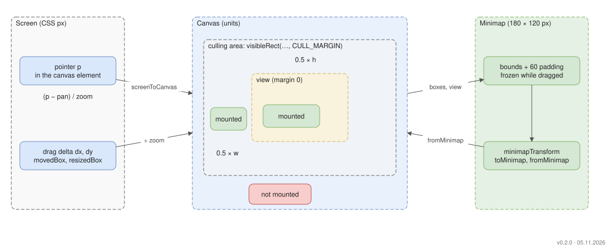

# Canvas

This page describes the `canvas` module: which file does what, the gesture and save rules that the code does not explain by itself, how page elements are kept, and the CSS contract with the editor.

Screen pixels, canvas units and the minimap are three coordinate spaces; the formulas live in `geometry.ts` and are named in the diagram.

## Module map

All in [`application/src/renderer/src/canvas`](../../../../application/src/renderer/src/canvas); other modules use only the barrel `index.ts` (`CanvasView`, `startContentSync`).

| File | Role |
|---|---|
| `CanvasView.tsx` | one canvas: draws the text boxes at `translate(pan) scale(zoom)`, culls, creates a box on a double-click, shows the hint or the load error |
| `TextBox.tsx` | one text box: TipTap editor, toolbar while focused, move, resize, delete |
| `useViewport.ts` | pan and zoom state, the element size, wheel and pan gestures |
| `ZoomControls.tsx`, `Minimap.tsx` | the − / + / Reset buttons; the 180 x 120 overview |
| `geometry.ts` | pure coordinate maths without React |
| `model.ts` | element types, `parsePageContent`, `newTextBox` |
| `contentStore.ts` | `useContentStore`: open content, load, save ([content lifecycle](../notebook/content-lifecycle.drawio.svg)) |
| `testHooks.ts` | test stand-in for React's `useRef` and `useState`, so tests can call `TextBox` and `Minimap` as plain functions |

## Drag starts after 3 px

A press on an unfocused text box only records its position. The drag starts with the first `pointermove` at least 3 px away (`DRAG_THRESHOLD`, `dragOffset`).

- Why: `usePointerDrag` captures the pointer on the box. With the capture the click that follows the press goes to the capturing box, so a button, a jump link or a ledger input inside an unfocused box would never receive its click. Waiting keeps a plain click a plain click.
- The drag takes its start from the event it receives, which is the crossing move. `dragOffset` returns the way from the press to that move, `TextBox` keeps it as `lead` and adds it to the deltas, so the box stays under the pointer from the press on.
- A `pointermove` with the primary button up cancels a pending press (the pointer may have been released outside the box). A focused box starts no drag, because its content takes the pointer. The resize corner starts at the press and needs no threshold.
- Deltas are screen pixels and the surface is scaled, so `movedBox` and `resizedBox` divide them by the zoom. The minimum size is 120 x 60 (`MIN_BOX_SIZE`).

## Save once on pointer up

While a box is dragged or resized, `updateElement` changes the store so the box follows the pointer, and nothing is saved. `TextBox.finish` runs once on pointer up and calls `commitElement` with the last patch; the store saves 400 ms after the last commit. Typing commits the content the same way. `addElement` and `deleteElement` save at once.

## Wheel and pan

| Input | Result |
|---|---|
| Ctrl or Meta + wheel, anywhere | zoom by `-deltaY × 0.001`, between 0.2 and 3, not anchored at the pointer |
| wheel over the empty canvas | pan by the wheel deltas |
| wheel over a text box | nothing: the box scrolls (`wheelAction` gives `ignore`) |
| middle button, or Alt + left button, drag | pan |

- The wheel listener is a native, non-passive listener on the canvas element, because React's `onWheel` is passive and could not stop the page from scrolling.
- Pan uses `usePointerDrag`, so a release outside the window ends it. An unfocused text box takes a left press first, so Alt + drag over such a box moves the box.
- The − / + buttons step the zoom by 0.1; Reset returns to pan 40, 40 and zoom 1. The viewport is not saved.
- The minimap appears when the page has a text box and the canvas size is known. A click or drag recenters the canvas (`centerOn`); its bounds are frozen during the drag, otherwise the moving view would rescale the map under the pointer.

## Culling

`CanvasView` mounts only the text boxes that meet the culling area (`CULL_MARGIN` = 0.5: the visible area grown by half its size on every side; touching counts) and the focused box wherever it is. Until the canvas has a measured size, all boxes are mounted. The minimap always uses all boxes.

## Elements

- `parsePageContent` keeps unknown fields, and every element whose `type` is not `textbox` (such as `image` or `file`) stays a `ForeignElement`. `CanvasView` draws only text boxes, but each save writes the whole element list, so foreign elements survive. A page with only foreign elements shows no hint; the hint "Double-click anywhere to add a text box" appears only when there is no element at all.
- A double-click on the empty surface (not on a box, the minimap or the zoom controls) creates a 320 x 200 box at the pointer with `zIndex` highest + 1.
- A text box whose content the editor cannot display becomes read-only with a notice; it still moves and resizes, and the commits then carry only `x`, `y` or `width`, `height`, so the stored content stays ([feature registry](../editor/feature-registry.md)).

## CSS contract with the editor

`TextBox` puts the class `tiptap-editor` on the element that wraps the editor, and marks every box with `data-canvas-element` (the wheel rule finds a box with it). `editor/editor.css` and the CSS next to each block (`callout.css`, `table.css`, `linkList.css`) select `.tiptap-editor .ProseMirror …`. A class renamed on one side only removes the editor styles without an error; `TextBox.test.ts` pins the name.
