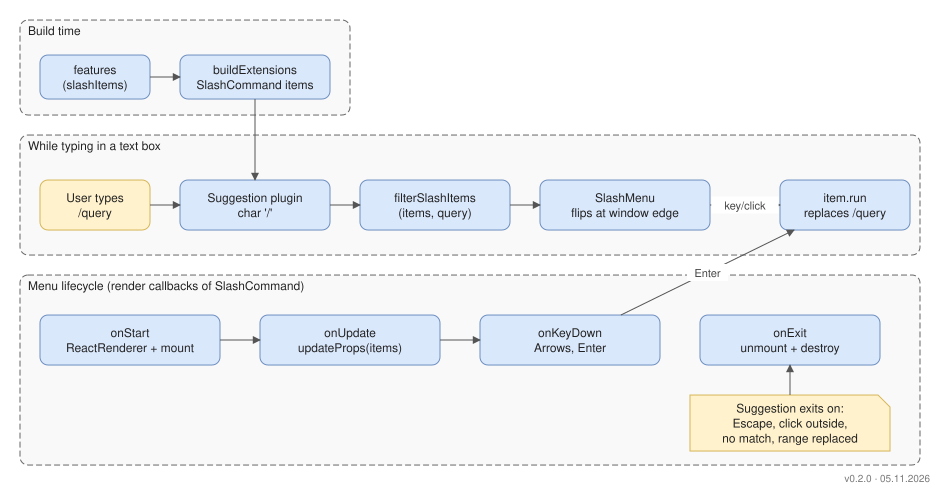
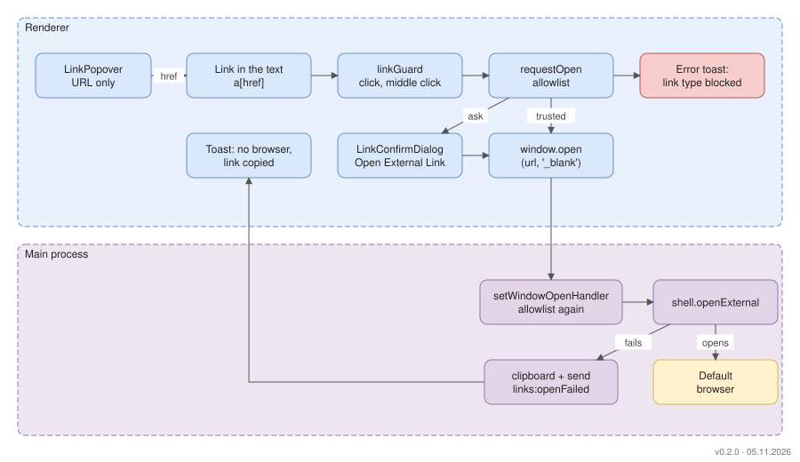

# Editor feature registry

How a text box gets its blocks: a fixed list of features, each adding TipTap extensions and slash items, built into one editor per text box.

Code paths without a prefix are relative to `application/src/renderer/src`.

## Contract

| Name | Where | Role |
|---|---|---|
| `EditorFeature` | [`editor/feature.ts`](../../../../application/src/renderer/src/editor/feature.ts) | `{ name, extensions, slashItems }`: what one feature adds |
| `SlashItem` | same file | One slash menu entry: `id`, `title`, `description`, `icon`, `keywords`, `run(editor, range)` |
| `filterSlashItems` | same file | Keeps the items whose title or a keyword contains the query |
| `buildExtensions(features)` | [`editor/extensions.ts`](../../../../application/src/renderer/src/editor/extensions.ts) | Base editor, table rows and cells, legacy nodes, link guard, `SlashCommand` (items of all features), then the extensions of all features |
| `coreBlocks` | [`editor/blocks/index.ts`](../../../../application/src/renderer/src/editor/blocks/index.ts) | The editor's own feature: callout, table of contents, page hierarchy, table |
| `financeFeature`, `financePlaceholderFeature` | [`finance/feature.ts`](../../../../application/src/renderer/src/finance/feature.ts), [`finance/nodes.ts`](../../../../application/src/renderer/src/finance/nodes.ts) | The finance blocks with or without their UI |
| `editorFeatures` | [`app/editorFeatures.ts`](../../../../application/src/renderer/src/app/editorFeatures.ts) | The list the app uses; the only place that knows both sides |

```text
editorFeatures ─▶ ContentArea ─▶ CanvasView ─▶ TextBox (prop features) ─▶ useNoteEditor ─▶ buildExtensions
```

The editor never imports finance. `editorFeatures` is `[coreBlocks, financeFeature]`, or `[coreBlocks, financePlaceholderFeature]` when `FEATURE_FINANCE` is false (see [architecture](../../architecture.md)).

## Add a block

1. Write the node in `editor/blocks/<name>.ts`: a TipTap `Node` in group `block`. Its node type name is persisted and never changes.
2. Export its slash item next to it; `run` replaces the typed `/query` range, usually with `replaceRangeWith(editor, range, content)`.
3. Put its styles in `<name>.css` next to the block and import the file from the block.
4. Add the node to `coreBlocks.extensions` and the item to `coreBlocks.slashItems`. A block of another module is that module's own `EditorFeature`, exported from its barrel and added to `editorFeatures`.
5. Run the tests: `app/editorFeatures.test.ts` and `app/schema.test.ts` check that slash item ids and extension names are unique and that every slash item inserts only node types the schema registers.
6. Add the new terms to [`glossar.md`](../../../glossar.md).

A block whose content is computed on render is an atom with a plain DOM view: see [live blocks](live-blocks.md). The table has its own page: [table](table.md).

## Finance blocks without finance

`finance/nodes.ts` holds the schema-only nodes `financeLedger` and `financeStats` (no React, nothing from the finance UI or store). Both features extend the same nodes:

| | `financeFeature` | `financePlaceholderFeature` |
|---|---|---|
| View | React (`LedgerBlock`, `StatisticsBlock`) | Plain DOM: "Finance module not included in this build" |
| Slash items | `ledger`, `statistics` | none |

A finance-off build keeps the stored nodes: the page loads, every attribute round-trips through one `data-*` attribute, and the page saves as it was loaded. Both nodes are registered in both builds; the placeholder only has no slash item, so a finance-off build creates no new blocks and no ledger files. More in [finance persistence](../finance/persistence.md).

## Content check

`useNoteEditor({ content, features, onUpdate, onContentError })` takes the content once (`useState`) and memoizes the extension list per `features` reference, so pass a module constant such as `editorFeatures`.

- It sets `enableContentCheck: true`. Without it TipTap loads unknown content as an empty document and the next save erases it.
- Content this version cannot display (a node type no feature registers, or content that is no document) makes the editor read-only (`setEditable(false, false)`, so no update event). `TextBox` shows "Read-only: this text box contains content this version cannot display. The stored content stays unchanged." and commits nothing.
- Moving or resizing such a box still works and keeps its stored `content` (see [canvas](../canvas/canvas.md)).

## Legacy nodes

`legacyNodes` (`editor/blocks/legacy.ts`) registers `templateLink` (attrs `kind`, `targetId`, `label`) because v0.1.x pages contain it. It is load-only: a click opens the page for kind `page`, kind `heading` does nothing. Never remove a registered node type: every text box that holds it would turn read-only. A heading `id` attribute that old pages carry is dropped on load; nothing reads it.

## CSS next to the block

Each block imports its own CSS (`callout.css`, `linkList.css`, `table/table.css`); `editor.css` holds the generic text styles and is imported by `useNoteEditor`. `app/global.css` holds Tailwind, the base layer, the full height of `html`, `body` and `#root`, and the `body` colours (light and `.dark`).

The class contract: `canvas/TextBox.tsx` puts `tiptap-editor` on the `EditorContent`, and every editor rule is written `.tiptap-editor .ProseMirror …` (dark mode: `.dark .tiptap-editor …`). A block rendered outside a text box gets no styles.

## Slash command



Items come from `buildExtensions`, in feature order. `SlashCommand` (`editor/slash-command/`) wraps `@tiptap/suggestion` with `char: '/'`.

- Each `onStart` builds a new `ReactRenderer(SlashMenu)` and mounts it with Suggestion's `props.mount`; `onExit` is the only place that unmounts and destroys it. Suggestion calls `onExit` on Escape, on a click outside the menu, when the text no longer matches `/query` and after `run` has replaced the range.
- `props.mount` appends the menu to `document.body` and positions it with Floating UI below the caret. Near the window edge it flips to the other side, and it follows scroll and resize.
- `onStart` has no items yet; the filtered items arrive with `onUpdate`. `onKeyDown` forwards the keys to `SlashMenu` through its imperative handle: ArrowUp and ArrowDown wrap, Enter runs the item. Escape is handled by Suggestion itself (`SlashMenu` returns false for it). A mouse press runs an item without taking the focus from the editor.
- A keyword may be German (`hinweis`, `tabelle`); it is a search alias and never shown.

## Links



- **Create.** `LinkPopover` takes URLs only. `applyLinkInput` removes the link for an empty input, rejects an input outside the allowlist with "Enter a web address or a mailto: link." and changes nothing, and otherwise runs `extendMarkRange('link').setLink({ href })`, so a caret inside a link edits the whole link. A link takes a URL only.
- **Guard.** `linkGuard` listens to the DOM `click` and to the middle button's `auxclick`, because ProseMirror's `handleClick` runs on `mouseup` and cannot stop a native navigation. It calls `preventDefault` and passes the `href` as written to `useLinkStore.requestOpen`, in editable and read-only boxes. `buildExtensions` sets the link's `openOnClick: false`.
- **Allowlist.** `requestOpen` normalizes the input (leading and trailing whitespace is trimmed, no scheme: `https://`) and checks `isAllowedExternalUrl` from `application/src/shared/links.ts`: only `http:`, `https:` and `mailto:`. Whitespace, control characters and backslashes inside the address are rejected, so the dialog shows exactly the address that opens (the URL parser drops tabs and newlines and reads `\` as `/`). A blocked link shows the error toast "This link type cannot be opened.".
- **Confirm or trust.** A trusted link (`mynote-trust-external-links` is `true` in localStorage) opens at once; any other waits for `LinkConfirmDialog`, and `confirmOpen` checks that exactly the string shown still passes. The dialog's "Don't ask again" option stores the trust; a trusted link never shows the dialog.
- **Main.** `window.open` reaches `setWindowOpenHandler` in `application/src/main/window/externalLinks.ts`, which applies the same allowlist, opens with `shell.openExternal` and always denies a new window. If no browser opens, main copies the URL to the clipboard and sends `links:openFailed`; `App` shows the toast "No browser available — link copied to clipboard:" followed by the URL. See [IPC](../../main/ipc.md).
- **Limit.** Links of other schemes (`tel:`, `ftp:`) can still arrive by paste or autolink, because TipTap's default `isAllowedUri` is wider than the allowlist; they are refused on open.
