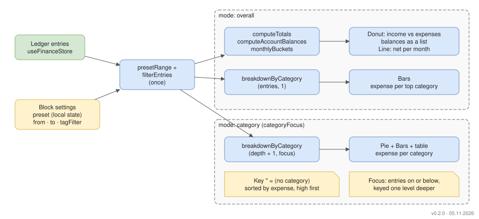
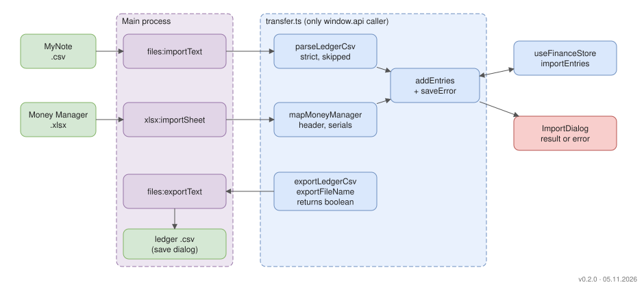

# Finance persistence

How the finance store reads and writes its files, which errors it reports and where, and the rules of the ledger UI that decide when a typed value is stored.

Code paths without a prefix are relative to `application/src/renderer/src`.

## Store contract

`useFinanceStore` ([`finance/store.ts`](../../../../application/src/renderer/src/finance/store.ts)) holds `ledgers` by id, `accounts`, `categories` and `referenceError`. A ledger is `{ meta, entries, saveError, loadError }`. All file access goes through `storage`; the files are described in [data files](data-files.md).

| Action | Rejects |
|---|---|
| `loadLedger`, `loadReferenceData` | never; a failure lands in `loadError` or `referenceError` |
| `addEntry`, `importEntries`, `updateEntry`, `deleteEntry`, `saveLedgerColumns` | only for a failed precondition: invalid id, ledger not loaded, `loadError` set, ledger being deleted (`saveLedgerColumns` also for invalid settings). A failed write is recorded in `saveError` instead |
| `createLedger` | invalid id, id already in the store, failed write |
| `deleteLedger` | invalid id, failed removal |
| `ensureAccounts`, `ensureCategories`, `saveAccounts`, `saveCategories` | `referenceError` set, invalid data, failed write |
| `listLedgers` | the listing of the `ledgers/` folder fails; an unreadable meta falls back to the id as name |

Event handlers wrap a call in `notifyFailure(promise)`, which turns a rejection into an error toast, so none stays unhandled.

## Write path

An entry or column change sets the state first and then writes: the CSV every time, the meta only when its text differs from the last meta text queued for that ledger (a failed meta write forgets the text, so the next write retries it). `storage` queues writes per path, one in flight, the newest text wins.

A failed write keeps the change in the state, sets `saveError` and leaves the file as it was, because main writes atomically. The next successful write clears `saveError`. Entry and column actions do not reject for it.

## Load

`loadLedger` reads the meta and the CSV. Any failure gives an empty ledger with `loadError` set and every write to it refused, so its files are never overwritten: an invalid id, a corrupt meta, an unreadable file, a CSV with another header, or a row without 10 cells ("Entry row N has X cells, expected 10"; N counts the entry rows after the header, blank lines excluded). A later `loadLedger` reads again and clears the error once the files are readable; a readable ledger is not read again.

A stored ledger loads leniently: values stay as stored (v0.1.x amounts such as `12,5`) and no row is dropped; only the header and the cell count decide. An import is strict (see below).

## Reference data

A corrupt or wrongly shaped `accounts.json` or `categories.json` sets `referenceError` and blocks every write to both files; `loadReferenceData` clears it once both are readable. The five reference operations (`loadReferenceData`, `ensureAccounts`, `ensureCategories`, `saveAccounts`, `saveCategories`) run on one promise chain, so none works on data another is about to change, and each write re-reads the files first. `ensureAccounts(names)` returns a `Map` from trimmed name to account id; names come from Excel files and a plain object breaks on `__proto__`.

## Create and delete

- `createLedger(id, name)` takes a fresh id from the caller and does not look at the disk. The slash item makes the id with `newId()`, inserts the block at once and creates the ledger in the background; a failure is an error toast and the block stays.
- `deleteLedger(id)` checks the id, marks the ledger as being deleted, waits for `flushWrites()` so no queued write can bring a removed file back, removes the CSV and the meta, and drops the state. While it runs every update to that ledger is refused.
- A ledger is deleted only from its own block: `LedgerToolbar`, `ConfirmDialog`, then `removeLedgerBlock` (`deleteLedger`, then `deleteNode`). A rejected deletion keeps the block. A block without a valid ledger id says "Remove block" and never calls `deleteLedger`, because no file belongs to it. A statistics block never deletes.

## Ledger UI rules

- **Commit input.** Nothing is stored while typing. `CommitInput` keeps the raw text while focused and shows the formatted stored value otherwise. Blur or Enter runs `resolveCommit(raw, stored, validate)` and `settleEdit`: `unchanged`, `commit` (with the normalized text, `12,5` becomes `12.50`) or `invalid`. An invalid text is never committed; it stays visible with its message until the user edits again, presses Escape (back to the stored text) or the stored value changes, and Enter keeps the focus. A date input and a `select` commit on change; a cleared date is ignored.
- **Quit.** While an edit is active the input listens for `beforeunload` in the capture phase, before the canvas content store checks for unsent writes. `unloadCommit` commits a valid, changed text and never an invalid one.
- **Draft row.** `+ Add entry` needs an amount above 0 and an account. While the amount field shows an invalid text the draft still holds the last valid amount, so `addDraft` refuses with "Fix the amount first." instead of storing it.
- **Reference data dialog.** Save is disabled while `referenceError` is set or an opening balance holds an invalid text. `saveReferenceData` cleans both lists first: it drops accounts and categories whose trimmed name is empty, trims names and removes `/` from category names. A nameless category refuses with "A category needs a name." and nothing is written when subcategories with a name survive the cleaning; a nameless category whose subcategories are all nameless is dropped with them. Then it writes the accounts and the categories one after the other; a failure shows inline and the dialog stays open.
- **Errors in the block.** `ErrorBox` (red, `role="alert"`) keeps errors visible: `loadError` shows the message and "This ledger was not changed." with no table and no draft row, and the toolbar offers only Delete; `saveError` shows "Not saved: " and the message above the table; `referenceError` shows "Accounts and categories could not be read" with the message and disables the account and category pickers. While the reference data cannot be read, an entry with an unknown account shows "(unavailable)" instead of "(deleted account)". A toast is for a failed action.

## Statistics block

- **Settings.** The attributes `ledgerId`, `mode`, `from`, `to`, `categoryFocus` and `tagFilter` are saved in the page; the attribute names never change. The block's own controls change the values (`updateAttributes`: ledger, view, from, to, category focus), and only `tagFilter` has no control. The period preset (`This month`, `This year`, `Custom range…`) is local state and starts on `This month`. `parseStatsSettings` gives each attribute the type the block relies on, so a pasted or hand-edited page cannot make it throw.
- **Period.** `presetRange(preset, today, custom)`: `month` ends on the real last day of the month, `year` runs from 1 January to 31 December, `custom` uses `from` and `to` and leaves an empty side open.
- **Filter once.** `filterEntries` applies the range and `tagFilter` (an entry stays if it has any of the tags; there is no UI for it, but it is saved and honoured). Totals, balances, breakdown and monthly buckets all read the filtered list, so a balance is the opening balance plus the flow of the period.
- **Category key.** `breakdownByCategory(entries, depth, focusPath?)` keys an entry by its category path cut to `depth` levels. Entries without a category have the key `''` and show as "(no category)"; a real category of that name stays a different key. With a focus, only entries on or below that path are grouped, keyed one level deeper than the focus (an entry directly in the focus keeps the focus as its key). Buckets are sorted by expense, highest first; equal expenses keep the order in which the keys first appeared.
- **Charts.** `charts.tsx` draws plain SVG: `Pie` (a donut when it has an `innerRadius`), `Bars` and `Line`. Zero and negative values get no slice, `lineY` keeps deficit months inside the picture, and a single month is a flat segment. The donut of the overall view shows income against expenses with the net amount as centre label; the balances are a text list. An empty chart says "No data".
- **Errors.** The block shows `loadError` as "This ledger could not be read: …", `referenceError` as "Accounts could not be read: …. The balances are not shown." and a failed ledger listing (`loadLedgerChoices`, which never rejects) as "The ledger list could not be read: …", all in an `ErrorBox`. It never deletes a ledger.

## Import and export notes

`transfer.ts` is the one finance file that calls `window.api`. An import asks main for the file text (main shows the open dialog and reads the file), then `transfer.ts` itself runs the parser and `addEntries`; the export hands the CSV text to main, which shows the save dialog and writes the file, and returns a boolean (`false` = cancelled). The suggested file name is the ledger name with every character Windows forbids in file names and every control character replaced by `-`, then the ledger id and `.csv`; an empty name becomes `ledger`.

- **Strict import.** `parseLedgerCsv` needs the exact header ("This is not a MyNote ledger CSV" otherwise); a row counts as `skipped` unless it has 10 cells, a real calendar date, `type` income or expense and an amount `normalizeAmount` accepts. Blank rows are not counted. `mapMoneyManager` checks the header and reads dates only as Excel serials; see [Money Manager import](../../main/finance-xlsx.md) for the file reader. Both import channels refuse a file above 10 MiB.
- **Failed save after an import.** The entries are already in the ledger when the write fails. `transfer.ts` reads the ledger back after `importEntries`: a `saveError` throws "Entries were added but could not be saved (…). Do not import again: …", so no false success is shown, and any later entry change writes the whole CSV again. A ledger that is not loaded or has a `loadError` throws "Ledger … is not loaded" or "Ledger … could not be read: …" instead, and this is checked before anything is added.
- **Formulas.** The CSV export writes cell text unchanged. A cell that starts with `=`, `+`, `-` or `@` is read as a formula by Excel, and the export contains the `referenceLink` paths as typed. Escaping would break the exact re-import, so this stays a note.
- **German Excel.** A German Excel re-saves a CSV with `;` as separator. MyNote refuses such a file on import and on load of a stored ledger (the header check fails; the file is not rewritten). Save it as "CSV UTF-8 (comma delimited)" instead.
- **Another notebook.** A MyNote CSV imported into another notebook keeps `accountId` as text. Ids that do not exist there show as "(deleted account)" and count in no balance; account names are not part of the CSV.

## Finance off

`FEATURE_FINANCE` is a build-time constant (`MYNOTE_FINANCE=off` turns it off). `app/editorFeatures.ts` then picks `financePlaceholderFeature`, and main registers no `xlsx:importSheet` handler. The blocks show "Finance module not included in this build"; their attributes are saved exactly as loaded. See [feature registry](../editor/feature-registry.md) and [architecture](../../architecture.md).
