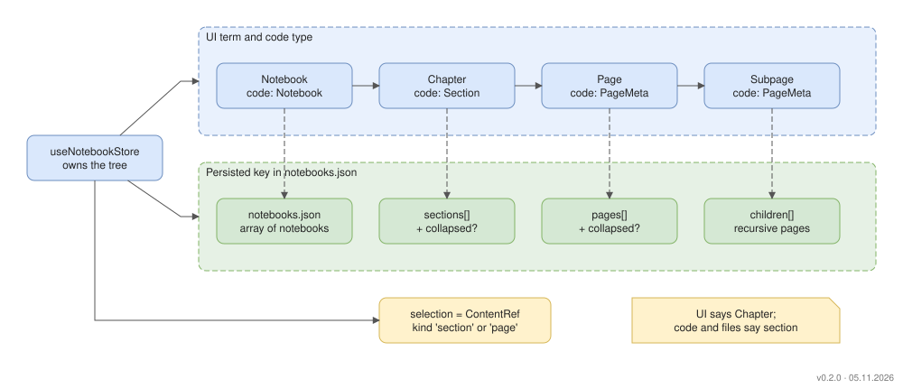
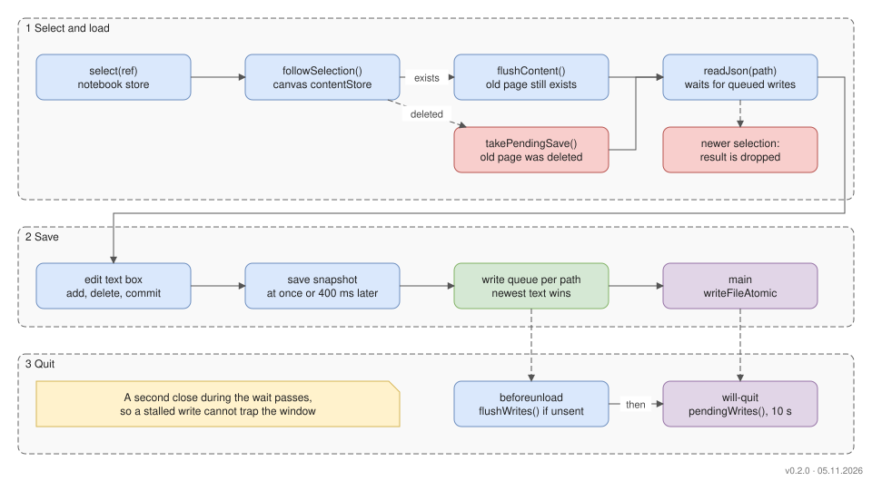

# Notebook module

This page explains the notebook tree and how the open page is loaded and saved: the data model with its persisted keys, and the content lifecycle with the rules around it.

Code: [`notebook`](../../../../application/src/renderer/src/notebook) (tree, store, manifest persistence, sidebar) and [`canvas/contentStore.ts`](../../../../application/src/renderer/src/canvas/contentStore.ts) (the open content).

## Data model

The user sees notebook, chapter, page and subpage; the code and the files call a chapter `Section` (stored under `sections`), and a page carries `sectionId`.

- `useNotebookStore` owns the whole tree. Every change goes through `commit`, which applies a pure helper from `tree.ts`, clears a selection that no longer resolves in the same update, and rewrites the whole `notebooks.json`.
- Loading (`parseNotebooks`) checks the ids against the id pattern and the field types (a wrong type is rejected), rejects the reserved notebook id `finance` in any case, rejects a repeated id compared without case (checked per kind: notebook, chapter, page), fills missing `sections`, `pages` and `children` with `[]` and keeps unknown fields. A failed check is a corrupt file: the store sets `openError`, keeps `dataRoot` null and writes nothing.
- `selection` is a `ContentRef`: a chapter note (`kind: 'section'`) or a page (`kind: 'page'`). It is not saved.
- `contentPath` maps a reference to its file: `<notebookId>/<sectionId>/page.json` for a chapter note, `<notebookId>/<sectionId>/<pageId>/…/page.json` for a page, with a subpage folder inside its parent's. Adding a page creates no folder; the file appears with the first content save.
- Deleting writes the manifest first and removes the folder second, so a failed removal leaves only a folder no entry points to.

## Content lifecycle

From selecting a page to quitting, in three phases.

1. **Select and load.** The content store follows `selection` only, not a change of the tree; selecting the open content again reloads it only after a failed load.
   - On a switch the pending save of the old content is sent at once (`flushContent`). When the old content was deleted (it no longer resolves) the save is dropped, because sending it would recreate the folder with a lone `page.json`.
   - Each load gets a request number. A result applies only while its number is still the latest, so a slow load of an earlier page cannot replace the current one.
   - A missing file opens empty and is created by its first save. A corrupt file sets `error`, leaves `content` null and is never saved.
   - `readText` waits for the writes queued for the same path, so reopening a page that was just edited reads its newest text.
2. **Edit and save.** `addElement` and `deleteElement` save at once; `commitElement` saves 400 ms after the last commit; `updateElement` never saves. A save goes to the path its content was loaded from, never to another page. `storage` sends one write per path at a time and the newest text wins; main writes atomically ([files](../../main/files.md)).
3. **Quit.** On `beforeunload` the pending save is sent. If text is still queued behind an in-flight write, the close is cancelled until `flushWrites()` resolves and then `window.close()` runs again. A second close during that wait passes, so a stalled write cannot trap the window. Main adds its own wait for writes in flight on `will-quit`.

Related: [canvas](../canvas/canvas.md), [file format](../../file-format/file-format.md), [glossary](../../../glossar.md) rows Manifest, Content ref and Content store.
